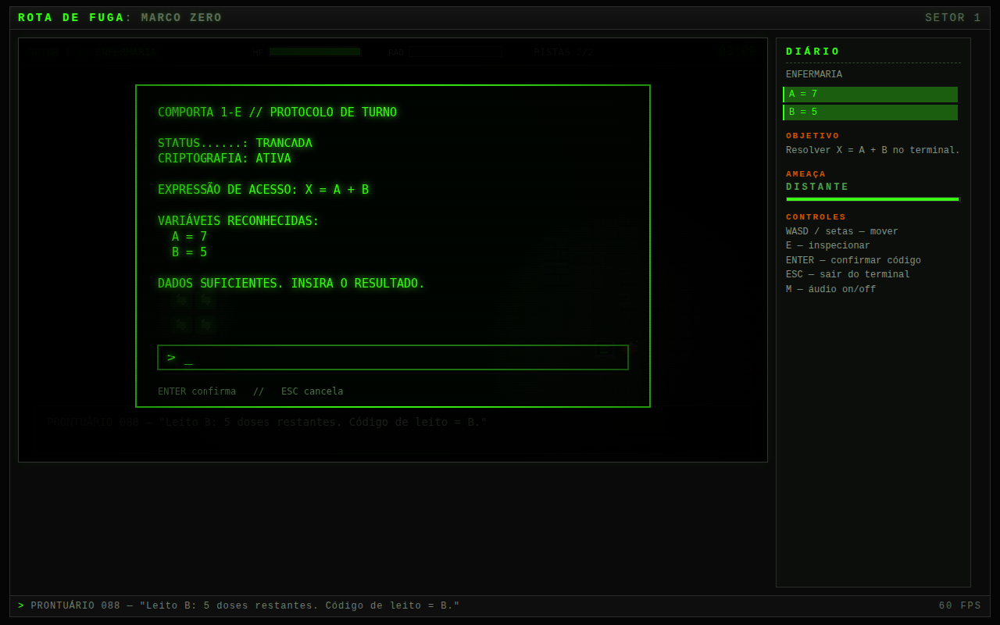

# Rota de Fuga: Marco Zero

Jogo sério 2D, com visão de cima, de sobrevivência e quebra-cabeça matemático.
Desenvolvido para a disciplina **PAC Extensionista** do curso de Engenharia de
Software do Centro Universitário Católica de Santa Catarina — Joinville.



> **Para só jogar, sem instalar nada:** baixe o projeto (seção 3) e abra o
> arquivo `dist/rota-de-fuga-standalone.html` com duplo clique.

---

## Sumário

1. [Sobre o jogo](#1-sobre-o-jogo)
2. [Requisitos](#2-requisitos)
3. [Como baixar o projeto](#3-como-baixar-o-projeto)
4. [Instalação e configuração](#4-instalação-e-configuração)
5. [Como executar](#5-como-executar)
6. [Como jogar: partida e controles](#6-como-jogar-partida-e-controles)
7. [Objetivo, regras, vitória e derrota](#7-objetivo-regras-vitória-e-derrota)
8. [Limitações conhecidas e o que ainda não foi implementado](#8-limitações-conhecidas-e-o-que-ainda-não-foi-implementado)
9. [Documentação do projeto (GDD)](#9-documentação-do-projeto-gdd)
10. [Estrutura do código e ferramentas](#10-estrutura-do-código-e-ferramentas)
11. [Equipe](#11-equipe)

---

## 1. Sobre o jogo

Depois de uma guerra nuclear, um engenheiro civil precisa atravessar os cinco
setores de um bunker militar abandonado antes que saqueadores o alcancem. Ele não
tem armas. As portas do bunker estão trancadas por senhas que os militares
deixaram como **expressões matemáticas incompletas**, e os valores que faltam
estão espalhados pelo cenário — em prontuários, fitas cassete, painéis e crachás.

A proposta é fazer da matemática a ferramenta de sobrevivência, e não uma prova:
o jogador explora, junta as variáveis, resolve a expressão no terminal da porta e
escapa. A dificuldade cresce setor a setor, de uma soma simples até álgebra com
potência e divisão, enquanto o tempo para resolver diminui.

**Público-alvo:** estudantes do Ensino Fundamental II e do Ensino Médio, e
jogadores de puzzle em geral. **Classificação:** livre.

---

## 2. Requisitos

O jogo é uma aplicação web estática (HTML5, Canvas 2D e JavaScript). **Não usa
engine** — não é necessário instalar Unity, Godot nem compilador. Funciona offline.

### Para jogar

| Item | Requisito |
|---|---|
| Sistema operacional | Windows 10 ou 11, macOS 12 ou superior, ou Linux |
| Navegador | Google Chrome 90+, Microsoft Edge 90+ ou Mozilla Firefox 88+ (recomendado: Chrome ou Edge atualizados) |
| Teclado | Obrigatório — o jogo não tem controle por mouse nem por toque |
| Tela | Resolução mínima recomendada de 1280 x 720 |
| Áudio | Opcional, mas recomendado: os sons fazem parte da tensão do jogo |

### Para rodar a partir do código-fonte (opcional)

Só é preciso um servidor HTTP local — qualquer um dos dois abaixo serve:

| Programa | Versão | Para quê |
|---|---|---|
| Python | 3.8 ou superior | servidor local com `python -m http.server` |
| Node.js | 18 ou superior (testado na 22) | servidor local com `npx http-server` |

### Para rodar os testes automatizados (opcional)

| Programa | Versão |
|---|---|
| Node.js | 18 ou superior |
| Playwright | instalado pelo `npm install` (baixa o Chromium automaticamente) |

---

## 3. Como baixar o projeto

### Opção A — clonar com Git

```bash
git clone https://github.com/ispanholito/rota-de-fuga-marco-zero.git
cd rota-de-fuga-marco-zero
```

### Opção B — baixar o ZIP (sem Git)

1. Na página do repositório no GitHub, clique no botão verde **Code**.
2. Clique em **Download ZIP**.
3. Extraia o arquivo numa pasta qualquer do computador.

---

## 4. Instalação e configuração

**Para jogar, não há nada para instalar nem configurar.** O jogo não tem
dependências: toda a arte é desenhada por código e todo o áudio é sintetizado em
tempo real pelo navegador, então não existem arquivos de imagem ou som a baixar.

O comando abaixo só é necessário para quem quiser rodar os **testes automatizados**
(seção 10):

```bash
npm install
npx playwright install chromium
```

---

## 5. Como executar

Escolha **um** dos caminhos abaixo.

### Caminho 1 — arquivo único (recomendado para avaliação)

Abra com duplo clique o arquivo:

```
dist/rota-de-fuga-standalone.html
```

Ele contém o jogo inteiro em um só arquivo. Abre direto no navegador, sem
servidor, sem internet e sem instalar nada.

### Caminho 2 — a partir do código-fonte, com Python

No terminal, dentro da pasta do projeto:

```bash
python -m http.server 8080
```

> No macOS e no Linux, use `python3` no lugar de `python`. No Windows, se
> `python` não for reconhecido, use `py -m http.server 8080`.

Depois, abra no navegador o endereço **http://localhost:8080**.
Para encerrar o servidor, volte ao terminal e pressione `Ctrl + C`.

### Caminho 3 — a partir do código-fonte, com Node.js

```bash
npm start
```

O navegador abre sozinho em **http://localhost:8080**.

### Caminho 4 — Visual Studio Code

1. Instale a extensão **Live Server** (autor: Ritwick Dey).
2. Abra a pasta do projeto no VS Code.
3. Clique com o botão direito em `index.html` e escolha **Open with Live Server**.

> **Por que o `index.html` não abre com duplo clique?** Ele carrega o código como
> módulos JavaScript, e os navegadores bloqueiam módulos abertos direto do disco
> (endereço começando com `file://`). O resultado é uma tela preta. Para jogar sem
> servidor, use o Caminho 1.

---

## 6. Como jogar: partida e controles

### Iniciando uma partida

1. Na tela de título, **pressione qualquer tecla**.
2. O jogo mostra o briefing do Setor 1. Aguarde o texto aparecer e pressione
   **Enter** para entrar no setor.
3. A partida começa: o cronômetro, no canto superior direito, já está correndo.

> O áudio só começa a tocar depois que você pressiona a primeira tecla. É uma
> regra dos navegadores, não um defeito do jogo.

### Controles

| Tecla | O que faz |
|---|---|
| `W` `A` `S` `D` ou setas | Movem o engenheiro nas quatro direções |
| `E` | Inspeciona o objeto à frente (revela uma variável) ou abre o terminal da porta |
| `0` a `9` | Digitam o código no terminal |
| `-` | Sinal de negativo — só pode ser o primeiro caractere do código |
| `Backspace` | Apaga o último caractere digitado no terminal |
| `Enter` | Confirma o código no terminal; avança nas telas de briefing, derrota e vitória |
| `Esc` | Fecha o terminal sem responder |
| `M` | Liga e desliga o áudio |

### Lendo a tela

| Elemento | Onde fica | O que significa |
|---|---|---|
| **HP** | barra superior | Vida do engenheiro. Se zerar, a partida termina. |
| **RAD** | barra superior | Contaminação por radiação. Cheia, passa a tirar vida. |
| **PISTAS** | barra superior | Quantas variáveis do setor você já encontrou. |
| **Cronômetro** | canto superior direito | Tempo até os saqueadores invadirem. Fica vermelho na reta final. |
| **Diário** | painel à direita | Lista automática das variáveis encontradas, objetivo atual e nível da ameaça. |
| **EM COBERTURA** | canto inferior esquerdo | Aparece quando você está colado a um caixote. |

---

## 7. Objetivo, regras, vitória e derrota

### Objetivo

Atravessar os cinco setores do bunker e sair pela comporta final, na Zona de
Quarentena, antes que os saqueadores alcancem o engenheiro.

### Como funciona cada setor

1. **Explorar** — o bunker é escuro; a lanterna ilumina só o entorno do personagem.
2. **Coletar** — objetos com **contorno verde piscando** escondem variáveis.
   Aproxime-se e pressione `E`. A variável vai para o diário automaticamente.
3. **Decodificar** — vá até o **terminal** (monitor verde) e pressione `E`. Ele
   mostra a expressão da porta. Calcule, digite o resultado e pressione `Enter`.
4. **Escapar** — com o código certo, a **comporta** na borda direita do mapa se
   abre (aparece a palavra SAÍDA). Caminhe até ela para ir ao próximo setor.

### Regras

- **O terminal só aceita resposta quando você tem todas as variáveis.** Se faltar
  alguma, ele avisa qual é, e não há penalidade.
- **Errar o código custa 10 segundos** do cronômetro e dispara o alarme.
- **O tempo não para no terminal.** O cronômetro continua correndo enquanto você
  calcula.
- **Radiação:** pisar nas poças verdes enche a barra RAD. Fora delas, a barra
  esvazia devagar. Com a barra cheia, o engenheiro perde vida, anda mais devagar e
  a lanterna ilumina menos. O estalo do contador Geiger acelera conforme você se
  aproxima de uma poça.
- **Furtividade:** andar colado a caixotes deixa o engenheiro com metade da
  velocidade, mas silencioso — enquanto você estiver em cobertura, o cronômetro
  corre mais devagar (60% do ritmo normal).
- **Ameaça:** quando restam 35% do tempo, o estado da ameaça passa de DISTANTE para
  APROXIMANDO — a tela ganha um tom vermelho e o pulso da trilha sonora acelera.

### Progressão

Cada setor tem uma expressão mais difícil e menos tempo:

| Setor | Área | Conteúdo matemático | Tempo |
|---|---|---|---|
| 1 | Enfermaria | Adição | 3 min 10 s |
| 2 | Alojamentos | Parênteses e regra de sinais | 2 min 45 s |
| 3 | Sala de Máquinas | Equação de 1º grau | 2 min 30 s |
| 4 | Centro de Comando | Potência e prioridade das operações | 2 min 15 s |
| 5 | Zona de Quarentena | Expressão com multiplicação, divisão e soma | 1 min 50 s |

### Vitória e derrota

- **Vitória:** atravessar a comporta do Setor 5. A tela final mostra o tempo total,
  os códigos decifrados e o número de tentativas erradas.
- **Derrota:** o cronômetro zerar (os saqueadores invadem o setor) **ou** a vida
  zerar por radiação.
- **Depois de uma derrota**, pressione `Enter`: a partida recomeça **do Setor 1**.

<details>
<summary><strong>Gabarito dos cinco terminais (spoiler — para avaliação)</strong></summary>

| Setor | Expressão | Variáveis | Resposta |
|---|---|---|---|
| 1 | `X = A + B` | A = 7, B = 5 | **12** |
| 2 | `X = (A * B) - 15` | A = 5, B = -2 | **-25** |
| 3 | `2X + A = B` | A = 4, B = 18 | **7** |
| 4 | `X = A² - (B * 4)` | A = 6, B = 5 | **16** |
| 5 | `X = (A * B) / 3 + C` | A = 9, B = 4, C = 7 | **19** |

</details>

---

## 8. Limitações conhecidas e o que ainda não foi implementado

### Limitações da versão atual

- **Não há tutorial dentro do jogo.** As regras estão explicadas apenas neste guia.
- **Não há pausa.** O cronômetro só para nas telas de briefing, derrota e vitória.
- **Não há salvamento nem checkpoint.** Uma derrota sempre recomeça do Setor 1.
- **As expressões e os valores são fixos.** Cada setor tem sempre a mesma resposta,
  então uma segunda partida pode ser vencida de memória.
- **Só teclado.** Não há suporte a mouse, controle ou tela de toque — o jogo não
  funciona em celular ou tablet.
- **Tamanho de tela fixo.** A área de jogo tem 960 x 544 pixels; em janelas menores
  ela é reduzida, mas não aumenta em telas grandes.
- **O áudio depende da primeira tecla**, por política dos navegadores.
- **Testado principalmente no Chrome/Chromium.** Firefox e Edge devem funcionar;
  o Safari não foi testado.

### Funcionalidades previstas e ainda não implementadas

| Funcionalidade | Situação atual |
|---|---|
| Saqueadores visíveis, com rota de patrulha e detecção | A ameaça existe só como cronômetro e som |
| Geração de expressões com valores sorteados | Valores fixos por setor |
| Dicas progressivas no terminal após erros | Não há dica |
| Menu de opções (volume, dificuldade) | Apenas liga/desliga o som com `M` |
| Salvamento de progresso entre sessões | Não há |
| Relatório de desempenho por tipo de erro | A tela final mostra só totais |
| Terminais sem energia que precisam ser reativados | Previsto no GDD, não implementado |
| Suporte a toque e modo de alto contraste | Não há |

---

## 9. Documentação do projeto (GDD)

O **Game Design Document atualizado** está em
**[`docs/GDD.md`](docs/GDD.md)**. Ele descreve o jogo como está implementado nesta
versão, marca o que ainda é planejado e registra o que mudou em relação à versão
do semestre anterior.

As versões originais do PAC III, em Word, estão preservadas em
[`docs/pac-iii/`](docs/pac-iii/).

---

## 10. Estrutura do código e ferramentas

```
rota-de-fuga-marco-zero/
├── index.html                 página do jogo (versão com módulos)
├── dist/
│   └── rota-de-fuga-standalone.html   jogo em arquivo único (abre sem servidor)
├── src/
│   ├── main.js                ponto de entrada
│   ├── style.css              moldura da tela e painel do diário
│   ├── engine/                teclado, áudio sintetizado, utilitários
│   ├── game/                  regras, jogador, terminal, ameaça, desenho, arte
│   └── data/levels.js         os 5 setores: mapas, pistas, expressões e tempos
├── tools/                     validação, testes, build e gravação de vídeo
└── docs/                      GDD, capturas de tela e documentos do PAC III
```

Para alterar o conteúdo: os mapas, as variáveis, as expressões e o tempo de cada
setor ficam todos em `src/data/levels.js`. Depois de editar, rode
`npm run validate` e `npm run build` (este último atualiza o arquivo único).

| Comando | O que faz | Precisa de `npm install`? |
|---|---|---|
| `npm start` | Sobe um servidor local e abre o jogo | Não |
| `npm run validate` | Confere os 5 mapas: tamanho, se toda pista é alcançável a pé e se as respostas batem com as expressões | Não |
| `npm run build` | Gera `dist/rota-de-fuga-standalone.html` a partir de `src/` | Não |
| `npm test` | Joga a campanha inteira num navegador automatizado e falha se aparecer qualquer erro | Sim |
| `npm run record` | Grava um vídeo de demonstração da partida | Sim |

---

## 11. Equipe

| Integrante | Responsabilidade |
|---|---|
| Ana Beatriz Adriano da Silva | Concepção, game design e documentação |
| Ruan Pablo Amaral | Desenvolvimento e engenharia |

Centro Universitário Católica de Santa Catarina — Engenharia de Software — 2026.
